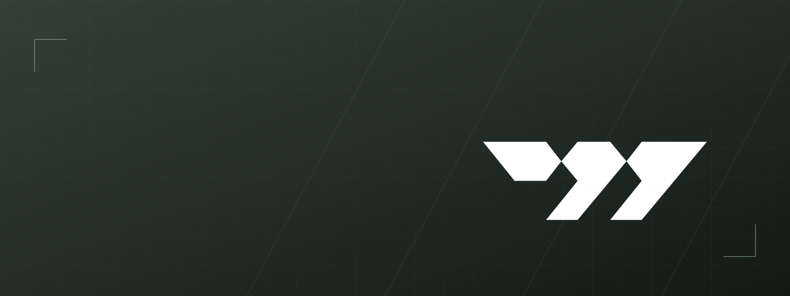

# WARLINK 1.0.0

**Développé et maintenu par STARZISMIK.** Launcher Windows communautaire.

## Version en validation

Le dépôt est privé. La version 1.0.0 est préparée en brouillon ; aucune archive de distribution n’est publiée avant validation de STARZISMIK. L’archive RAR sera ajoutée après validation.

## Fonctionnalités

- Choix de langue au premier lancement : français, anglais, espagnol, russe. Choix enregistré, modifiable dans les paramètres.
- Bibliothèque de jeux, Workshop et compatibilité de langue des contenus BO3.
- Gestion des serveurs HorizonMW, bots, cartes, messages et annuaire communautaire WARLINK.
- Discord WARLINK : https://discord.gg/3hrvcWNDPa ; compteurs approximatifs de membres et de personnes en ligne.
- Onglets Amis et Communauté optionnels, désactivés par défaut dans les paramètres.
- Vérification de version obligatoire au lancement et en session. Une version supérieure publiée impose le téléchargement et l’installation, ou la fermeture. Une vérification indisponible propose Réessayer ou Quitter.

## Installation après validation

Extraire toute l’archive RAR dans un dossier accessible en écriture, puis lancer WARLINK.exe. Ne pas extraire uniquement l’exécutable : les ressources du launcher sont requises. Pour mettre à jour, fermer WARLINK, extraire la nouvelle archive au même emplacement et conserver les dossiers de données utilisateur. Les paquets de publication ne contiennent aucune donnée personnelle du développeur.

## Mises à jour GitHub

Le fichier update.json reste désactivé jusqu’à une publication validée. Après passage public du dépôt : créer la release, joindre l’archive puis renseigner sa version et son lien GitHub dans update.json avec released=true. Le service Railway relaie ce manifeste ; aucun jeton GitHub n’est embarqué dans le launcher. Le canal privé de validation ne distribue pas automatiquement d’archive ; les testeurs recevront l’archive validée directement.

## Développement

Sources : src/ ; dépendances : deps/ ; outils locaux : dev/ ; annuaire Railway : community/. Application de travail unique : app/WARLINK.exe. Compiler avec Visual Studio 2022 x64, puis node dev/build.cjs. Préparer un paquet propre avec scripts/prepare-release.ps1.

## Licence et crédits

WARLINK est un logiciel dérivé distribué sous GPL-3.0. Les composants d’origine et leurs auteurs restent crédités dans [CREDITS.md](CREDITS.md) et [LICENSE](LICENSE). Les marques et clients de jeux appartiennent à leurs auteurs respectifs.
